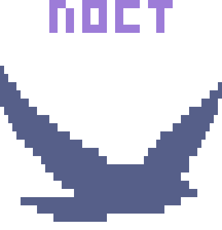

<p align="center">
  
</p>

<p align="center">
  <strong>Um workspace de terminais para quem testa.</strong><br>
  O noct roda seus shells, seu agente de IA e suas rotinas de teste repetitivas lado a lado, num único binário leve.
</p>

<p align="center">
  <a href="go.mod"></a>
  <a href="LICENSE"></a>
  
</p>

<p align="center">
  <a href="README.md">English</a> · <strong>Português</strong>
</p>

<p align="center">
  <a href="#por-que-o-noct">Por que o noct</a> · <a href="#instalação">Instalação</a> · <a href="#primeiros-passos">Primeiros passos</a> · <a href="#do-seu-jeito">Do seu jeito</a> · <a href="#scripts">Scripts</a> · <a href="#fluxos">Fluxos</a> · <a href="#ia">IA</a> · <a href="#sessões">Sessões</a> · <a href="#atualizações">Atualizações</a> · <a href="#documentação">Docs</a>
</p>

<p align="center">
  
</p>

> [!NOTE]
> **Beta.** A v0.1.0 é o primeiro beta: terminais, scripts, fluxos e a integração com IA já funcionam; espere mudanças antes da v1.0.0.

## Por que o noct

Testar é repetitivo, mas nunca exatamente igual: muda o ambiente, muda o usuário, muda o dado de entrada. Um script fixo não serve, e redigitar comandos é lento e propenso a erro. O conhecimento de *como* testar acaba espalhado entre histórico do shell, arquivos soltos e memória.

O noct junta tudo num lugar só:

- **Terminais de verdade, com a sua configuração.** Cada painel roda o seu shell com a sua configuração. Plugins, prompt e autocompletar funcionam como sempre.
- **Tabs e painéis ilimitados.** Deixe um servidor rodando, acompanhe um log, converse com um agente de IA e ainda tenha um shell livre, tudo na mesma janela.
- **Scripts com notas.** Salve as linhas de comando que você usa, com notas de como e quando rodar, a versão instalada e a ajuda a uma tecla de distância.
- **Fluxos sem scripts.** Encadeie scripts num editor visual com condições, repetições, esperas, variáveis e prompts que pedem um valor no meio da execução; params com tipo são preenchidos num formulário (`p` no inspect). Toda execução fica guardada, e um calendário mostra quando rodou e o log completo.
- **Uma IA que trabalha com você.** Via MCP, um agente de IA pode ler seus scripts, montar fluxos, executá-los e analisar os resultados, e nada novo roda sem a sua aprovação.
- **Leve.** Um único binário em Go, sem runtime para instalar.

## Instalação

Em Linux ou macOS, baixe o arquivo do seu sistema (`linux` ou `darwin`, `amd64` ou `arm64`) na [última release](https://github.com/AlexandreSJ/noct/releases/latest) e coloque o `noct` no `PATH`. Uma pasta sua, como `~/.local/bin`, deixa o noct se atualizar sem `sudo`:

```sh
tar -xzf noct_v0.1.1_linux_amd64.tar.gz noct
install -m 755 noct ~/.local/bin/noct
```

Com Go 1.24 ou mais recente:

```sh
go install github.com/AlexandreSJ/noct/cmd/noct@latest
```

Ou compile a partir do código:

```sh
git clone https://github.com/AlexandreSJ/noct
cd noct
go build -o noct ./cmd/noct
```

## Primeiros passos

Rode `noct`. Ele abre numa home vazia; aperte qualquer tecla para ver a tecla prefixo, que abre os comandos.

Aperte a tecla prefixo, `Ctrl+Space`, para entrar no **modo noct**. Nele, a navegação mantém o modo ligado, então você percorre painéis e tabs com um único prefixo:

| Tecla | Ação |
|---|---|
| Setas ou `hjkl` | Mover entre painéis; passando da borda, para a tab seguinte ou anterior |
| `Tab` / `Shift+Tab` | Trocar de tab |
| `t` | Nova tab, com terminal ou o painel escolhido no config |
| `p` | Novo painel de terminal: divide o painel atual, ou abre uma tab na home |
| `s` | Novo scripts panel: seus scripts, para rodar, editar e criar |
| `i` | Inspect: seus fluxos como fluxogramas, para montar passo a passo, rodar e revisar |
| `v` | Logs por dia num calendário colorido pela atividade, com tamanho, linhas e como cada execução terminou |
| `Space` | Buscar scripts, ações e tabs |
| `?` | Ajuda do programa rodando no terminal |
| `o` | Sessões: abrir, criar, renomear, fechar e apagar, e `f` filtra pelo nome |
| `y` | MCP: aprovar o que uma IA pede para rodar e adicionar o noct a um cliente de IA |
| `a` | Mover o painel com as setas, inclusive para outra tab |
| `n` | Redimensionar o painel com as setas |
| `w` | Empilhar os painéis do grupo com foco, como no zellij: o painel com foco ocupa a altura e os outros viram uma linha de título cada; de novo para dividir |
| `f` | Fullscreen: mostrar só o painel com foco, ou o layout de novo |
| `g` | Novo painel flutuante com terminal, sobre os outros; arraste a borda com o botão esquerdo para mover e com o direito para redimensionar |
| `r` | Renomear a tab |
| `e` | Renomear o painel; um nome vazio volta ao do programa |
| `[` | Rolar o histórico do terminal |
| `d` | Desconectar; os programas continuam |
| `x` | Fechar o painel; a tab fecha junto com o último painel, a não ser que o config mantenha tabs vazias |
| `c` | Atualizações: o que há de novo em cada versão e, quando sai uma mais nova, instalá-la |
| `,` | Config: tecla prefixo, as teclas de cada tela, atalhos diretos, tema, fundo, mouse, o que uma tab nova abre e se ela fecha quando fica vazia, editor, gerenciador de arquivos, pasta dos scripts, por quanto tempo e quanto guardar dos logs, quanto da saída dos passos os fluxos guardam |
| `q` | Sair, depois de confirmar: `Enter` ou `q` de novo |
| `b` | Travar os atalhos, para os programas recebê-los; andar continua valendo. De novo destrava |
| `Esc` | Cancelar |

Um popup lista essas teclas enquanto o modo noct está ligado. Onde o noct move algo e você não está digitando, `hjkl` valem como as setas, e em toda lista `PgUp`/`PgDn` andam uma página e `Home`/`End` vão às pontas.

Fora do modo noct, toda tecla vai direto para o programa no painel, exceto os **atalhos diretos**: `Alt` com uma tecla do modo noct roda o comando sem o prefixo (`Alt+→` muda o foco, `Alt+T` abre uma tab, `Alt+A` move o painel), e `Alt+Shift` com as setas move o painel direto. Isso tira do shell `Alt+F` e `Alt+D` (edição por palavra); o modificador pode virar `Ctrl+Alt` ou ser desligado no config. Todas as teclas dos modos, painéis e popups do noct também podem ser trocadas lá, em **Keys → binds of every screen**.

Os painéis se organizam como no i3 com autotiling: um painel novo abre ao lado do painel com foco se ele é mais largo que alto, senão embaixo. Mover um painel (`a`, ou `Alt+Shift` com as setas) pensa em colunas: para os lados, ele sai da coluna e vai para o mesmo lugar da coluna vizinha (ou para o fim dela, se estava sozinho); para cima e para baixo, anda pela coluna e, passando do primeiro ou do último lugar, ocupa a largura de cima ou de baixo, como no i3. `prefixo` + `w` empilha o painel com foco e os de baixo dele.

O mouse também funciona: clique numa tab ou num painel para selecioná-lo, clique num comando do popup do prefixo ou numa opção do config para rodá-lo ou mudá-la, arraste a linha entre dois painéis para redimensioná-los, role o histórico de um terminal com a roda e arraste sobre um texto para selecioná-lo; ao soltar, ele vai para a área de transferência. Programas que usam o mouse, como vim e htop, recebem os cliques.

## Do seu jeito

<p align="center">
  
</p>

`prefixo` + `,` (ou `Alt+,`) abre o config, salvo em TOML legível em `~/.config/noct/config.toml`; cada mudança vale na hora.

- **Teclas.** Defina o prefixo apertando-o: quantos modificadores quiser com uma tecla, mostrada como o seu terminal a manda, com um aviso quando ela tomaria uma tecla do noct ou de programas (`ctrl+c`, `ctrl+r`, o `ctrl+b` do tmux). **Binds of every screen** lista cada ação dos modos, painéis e popups do noct com suas teclas: `Enter` troca uma (com várias, `←→` escolhem qual antes), `a` acrescenta outra, `Delete` volta ao padrão. Dicas, popups e rótulos seguem as suas teclas.
- **Tabs.** Escolha o que uma tab nova abre (vazia, um terminal, scripts, fluxos ou logs) e se uma tab fecha junto com o último painel.
- **Aparência.** Sete temas, com o fundo do terminal ou o do tema; o calendário dos logs colore cada dia pelo quanto rodou nele. **New theme** e **edit theme** criam os seus: cada parte (nomes das tabs, bordas, títulos, listas, mensagens) ganha uma cor das 256 do terminal ou um `#rrggbb`, com uma pequena workspace ao lado da lista mostrando o resultado. Os temas são arquivos em `~/.config/noct/themes/`, então também podem ser escritos à mão (as chaves estão em `docs/temas.md`). Cada sessão guarda o próprio tema, e escolher uma sessão já a mostra nas cores dela.
- **Voltar ao padrão.** A última linha do config, e a das binds, volta tudo ao padrão, depois de um segundo `Enter`.

## Scripts

Um script é uma linha de comando com parâmetros, salva em `~/.local/share/noct/scripts/<nome>/script.yaml` (ou no `.noct/scripts/` de um projeto) com um `notes.md` ao lado:

```yaml
description: Log in to the API
program: curl
run: ./login.sh {{.env}} {{.user}}
params:
  - name: env
    choices: [dev, staging, prod]
  - name: user
    remember: true
```

Scripts podem ser agrupados em pastas dentro da pasta de scripts, e qualquer outra pasta de scripts pode ser adicionada pelo caminho (`a` no scripts panel); as pastas vêm primeiro na lista, fechadas (`+`) até `Enter` abri-las (`-`), e `n` pergunta se cria um diretório ou um script. Um script numa pasta é `pasta/nome`.

No scripts panel, `Enter` pergunta os parâmetros e roda o script num terminal ao lado, que fica aberto com o código de saída; `r` no painel da execução roda de novo. Na lista, `e` abre o formulário do script, onde `Enter` edita cada parte (linha de comando, descrição, parâmetros, notas) sozinha no seu editor (vim por padrão) e `Ctrl+S` salva; `n` cria um e `Ctrl+O` abre a pasta dos scripts. A pasta dos scripts, o editor e o gerenciador de arquivos ficam no config. O formato completo está em [docs/scripts.md](docs/scripts.md).

## Fluxos

Um fluxo encadeia scripts numa rotina de teste, salva em `~/.local/share/noct/flows/<nome>.yaml`. `Ctrl+Space` `i` abre o inspect, onde cada fluxo é um fluxograma montado passo a passo: rodar um script, `if`/`else`, `repeat` até uma condição, esperar, definir uma variável ou pedir um valor no meio da execução. Toda execução fica guardada com a saída de cada passo, e `Ctrl+Space` `v` as mostra num calendário.

Triggers disparam um fluxo sozinhos enquanto o workspace roda: num horário cron, quando arquivos mudam ou quando outro fluxo termina. `noct enable <fluxo>` os liga. Escrever um fluxo à mão está em [docs/writing-flows.md](docs/writing-flows.md) (em inglês).

## IA

`noct mcp` serve o noct a um cliente de IA como servidor MCP, dando a ele seus scripts, fluxos, execuções e painéis. No Claude Code:

```sh
claude mcp add noct -- noct mcp
```

`Ctrl+Space` `y` mostra o comando para outros clientes (Codex, Gemini CLI, VS Code, opencode, Cursor) e os clientes conectados agora. O que uma IA escreve é um **rascunho**, que não roda até você revisar e promover (`P` no inspect ou no scripts panel, ou `noct promote <nome>`), e os comandos que ela pede para rodar esperam a sua aprovação no mesmo popup. Ver [docs/mcp.md](docs/mcp.md).

## Linha de comando

| Comando | O que faz |
|---|---|
| `noct` | Conecta à última sessão usada, iniciando o noct se preciso |
| `noct attach [sessão]` (ou `a`, `att`, `-a`) | Conecta a uma sessão pelo nome; sem nome, lista as sessões |
| `noct new [sessão]` | Cria uma sessão, com nome ou número, e conecta a ela |
| `noct sessions` | Lista as sessões: aberta ou fechada, tabs, último uso |
| `noct kill <sessão>` | Apaga uma sessão: os programas param e o layout é esquecido |
| `noct -s <script> [nome=valor ...]` | Roda um script neste terminal |
| `noct ls` | Lista os scripts, a versão do programa e a pasta |
| `noct flow run <fluxo> [nome=valor ...]` | Roda um fluxo neste terminal, passo a passo |
| `noct flow ls` | Lista os fluxos, com os triggers ligados ou não |
| `noct enable <fluxo>` / `disable <fluxo>` | Liga ou desliga os triggers de um fluxo |
| `noct promote <fluxo ou script>` | Deixa rodar um rascunho que uma IA escreveu, depois de revisado |
| `noct mcp` | Serve o noct a um cliente de IA por stdin e stdout |
| `noct check` | Aponta os scripts e fluxos que não carregam |
| `noct quit` | Fecha todos os painéis e encerra o workspace; as sessões reabrem como estavam |
| `noct update` | Mostra o que há de novo nas releases depois desta e, se você concordar, instala a mais nova |
| `noct version` | Imprime a versão do noct |

`noct -h` mostra todas as opções.

## Sessões

Seus programas continuam rodando quando você fecha o terminal ou desconecta com `Ctrl+Space` `d`: rode `noct` de novo para voltar a eles.

Mantenha workspaces separados em sessões com nome: `noct new dev` cria uma, `noct attach dev` volta a ela, e `Ctrl+Space` `o` lista todas com o último uso de cada, para trocar, criar, renomear, fechar ou apagar. `noct` sozinho volta à última sessão usada.

Uma sessão fechada, ou todas depois de `noct quit`, guarda suas tabs e painéis: reabri-la inicia os shells nos diretórios em que estavam e os painéis do noct onde estavam. Um programa que rodava num shell, como `claude` ou `ssh`, não volta sozinho: o painel diz qual era, e `Enter` roda o mesmo comando de novo (`Esc` deixa o shell como está). Com os logs de terminais ligados (`[logs] terminals`), cada shell mostra também o fim do que tinha escrito e continua gravando no mesmo log. Execuções de scripts não voltam.

O daemon continua rodando a versão com que começou. Depois de recompilar o noct, saia (`Ctrl+Space` `q`) e rode `noct` de novo; o noct lembra disso na barra de tabs quando percebe um binário mais novo.

## Atualizações

A barra de tabs mostra a versão do noct antes do nome da sessão, e uma vez por dia o noct procura uma release nova no GitHub: quando sai uma, ela aparece ao lado da versão (`noct v0.1.0 ↑ v0.2.0`). `Ctrl+Space` `c` abre as atualizações: o changelog de cada versão, `u` para instalar a mais nova e, depois de instalada, `r` para reiniciar nela; as sessões reabrem como estavam, e os programas dos painéis podem rodar de novo com `Enter`. Nada é instalado nem reiniciado antes de você apertar uma tecla. Quando o noct está numa pasta que você não pode gravar, como `/usr/local/bin`, o popup mostra o comando que instala com `sudo`, e `y` o copia para colar num terminal. A procura diária pode ser desligada no config (**Updates → check for new versions**). No shell, `noct update` faz o mesmo. O que mudou em cada versão está no [CHANGELOG.md](CHANGELOG.md).

## Documentação

Os documentos de design estão em português; [docs/README.md](docs/README.md) é o índice.

| Documento | Sobre |
|---|---|
| [writing-flows.md](docs/writing-flows.md) | Escrever fluxos e scripts em YAML à mão (em inglês) |
| [scripts.md](docs/scripts.md) | Formato dos scripts, parâmetros, notas e a CLI |
| [fluxos.md](docs/fluxos.md) | Fluxos, triggers e o calendário |
| [mcp.md](docs/mcp.md) | As ferramentas dadas à IA e a política de aprovação |
| [tui.md](docs/tui.md) | Tabs, painéis, teclas e aparência |
| [roadmap.md](docs/roadmap.md) | Fases e o que está pronto |
| [CONTRIBUTING.pt-br.md](CONTRIBUTING.pt-br.md) | Regras de código e de escopo para pessoas e agentes de IA |

## Licença

[Apache 2.0](LICENSE) © [AlexandreSJ](https://github.com/AlexandreSJ)

A emulação de terminal e a renderização do noct são feitas sobre o [Ultraviolet](https://github.com/charmbracelet/ultraviolet) e o [x/vt](https://github.com/charmbracelet/x/tree/main/vt), da [Charm](https://charm.land). Cópias com correções ficam em [third_party/](third_party/README.md), sob as licenças MIT originais; ver [NOTICE](NOTICE).
